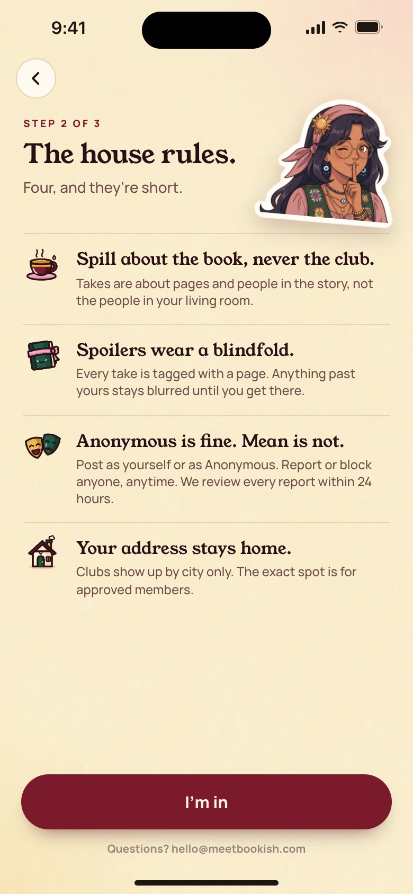
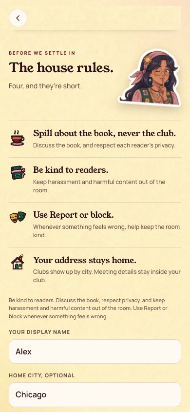
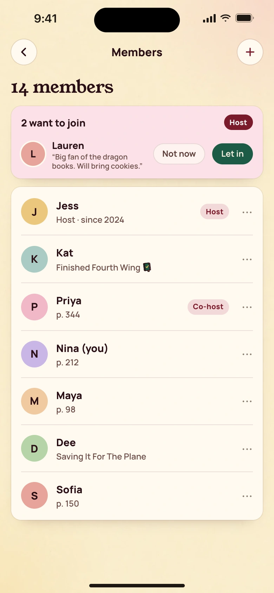
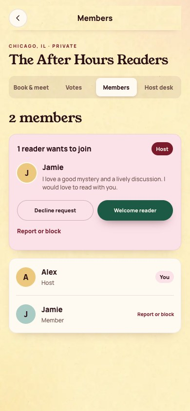

# Approved art parity evidence

Open [the GitHub comparison index](INDEX.md) for reviewable Markdown comparisons, or [the HTML comparison index](index.html) locally to review the approved reference beside the working app capture for each screen. Individual comparison pages live in [pages/](pages/). GitHub displays HTML source; for the rendered report, serve this directory locally and open it in Google Chrome.

```sh
python3 -m http.server 8771 --directory docs/approved-art-parity
```

Then visit `http://127.0.0.1:8771` in Google Chrome. This is a review server, not a deployment.

The [manifest](manifest.json) records the exact production bundle hashes, viewport, per-capture checks, approval receipts, and coverage status. The [native report](native/README.md) contains simulator renderings of the production UIKit classes. [Validation](VALIDATION.md) lists the checks and their limits. [Design tokens and reuse guidance](../../app/DESIGN.md) document the shared foundation.

The browser report contains 55 actual working app captures, including four- and six-digit code layouts, empty states, network and form errors, loading, member and host views, and 320px long-name and long-email stress cases. Browser requests are intercepted locally, so capture never sends account or club writes to a real backend.

Separate welcome, notification-prime, book-detail, join-approved, and club-started routes do not exist in this checkout. Scheduling, invitation sharing, meetings, and account editing are existing combined views. Their comparisons show the actual entry point or combined view and carry a partial status, rather than claiming exact screen parity. The Tea, bring lists, new reminders, and widgets are outside this ticket.

The long-email regression was reproduced before the CSS fix at both widths, with document widths of 551px and 550px. The [before-fix manifest](regressions/long-email-before/manifest.json) records both failing checks and preserves those screenshots. Final profile captures use the same valid 64-character email local part and pass against the requested 390px and 320px viewport widths. Run `node app/scripts/capture-parity.mjs --long-email-only` for a focused check of the current build; its output is separate from the preserved before-fix evidence.

Email code presentation accepts four digits and six through ten digits, preserves paste and autofill, and sends the complete code to the existing transport. The current backend still requires six through ten digits until PR #36 changes authentication. Four-digit verification here proves the UI and payload, not production four-digit authentication.

| Approved | Actual |
| --- | --- |
|  |  |
|  |  |

Reproduce the browser captures after building the app:

```sh
npm run build --prefix app
node app/scripts/capture-parity.mjs
```

Set `PLAYWRIGHT_MODULE` to an installed Playwright module if needed, and `BOOKISH_APPROVED_SOURCE` if the approved source directory differs. The capture script uses the installed Google Chrome channel. Native capture prerequisites and commands are documented in the native report.
