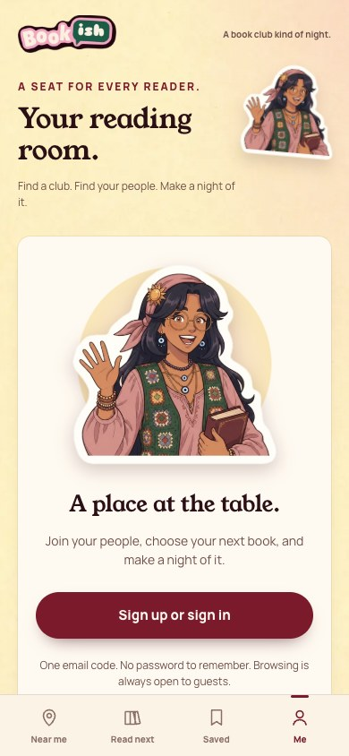

[All screens](../INDEX.md)

# 01. welcome

Oct 18 batch reference; individual approval not recorded in decisions 111-143.

**Partial: existing combined flow**

This is a partial mapping to working app behavior. The original screen composition and separate navigation are not fully implemented.

## Signed-out account entry

No standalone welcome screen exists. The shipped signed-out Me entry is shown.

| Approved reference | Actual app, 390 by 844 |
| --- | --- |
|  |  |

Overflow: none. Missing local assets: 0. Browser errors: 0. Em dash or emoji: none.

Original source: `/Users/vahallo/ted-screenshots/bookish-club/full-app-1016/html/01-welcome.html`.
