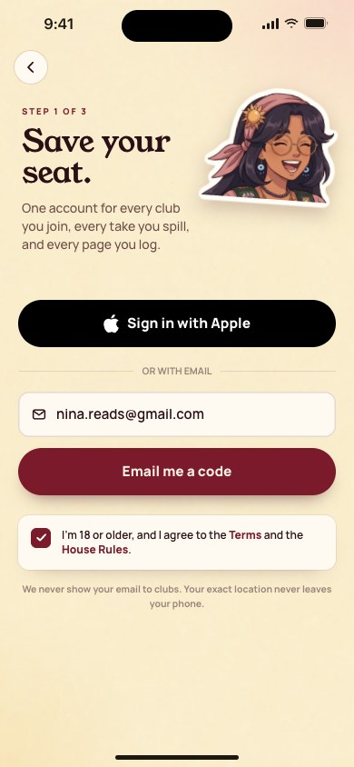
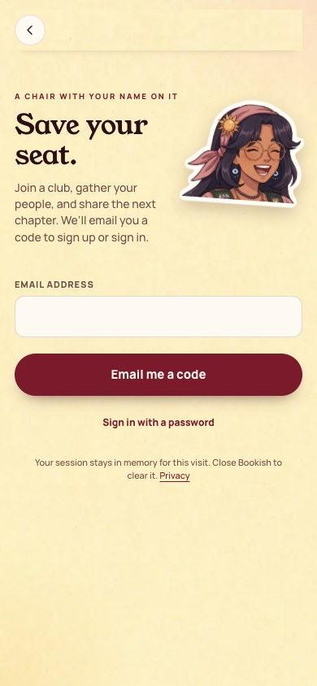
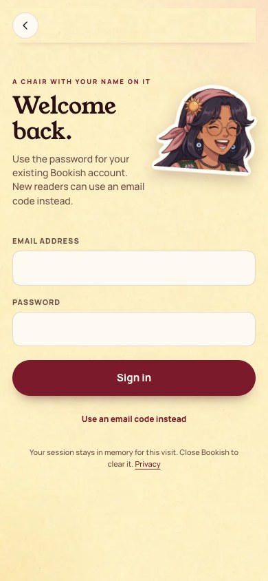
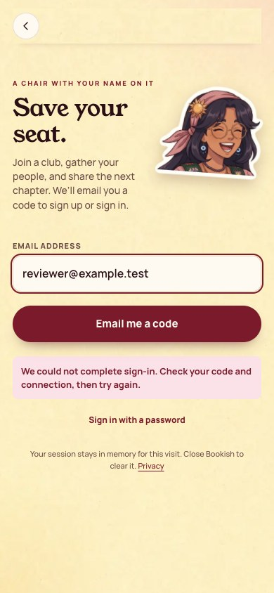

[All screens](../INDEX.md)

# 02. Sign in

Oct 18 approval receipt verified.

**Existing surface: visual adaptation**

## Email sign-in

| Approved reference | Actual app, 390 by 844 |
| --- | --- |
|  |  |

Overflow: none. Missing local assets: 0. Browser errors: 0. Em dash or emoji: none.

## Existing password sign-in

Working password sign-in is retained, although the approved art only shows email entry.

| Approved reference | Actual app, 390 by 844 |
| --- | --- |
|  |  |

Overflow: none. Missing local assets: 0. Browser errors: 0. Em dash or emoji: none.

## Sign-in form error

| Approved reference | Actual app, 390 by 844 |
| --- | --- |
|  |  |

Overflow: none. Missing local assets: 0. Browser errors: 0. Em dash or emoji: none.

Original source: `/Users/vahallo/ted-screenshots/bookish-club/full-app-1016/html/02-sign-in.html`.
