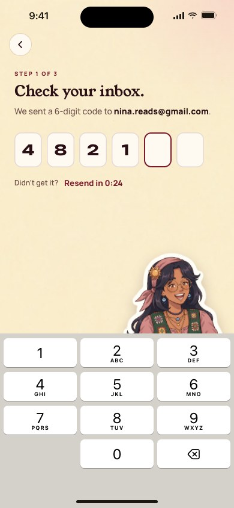
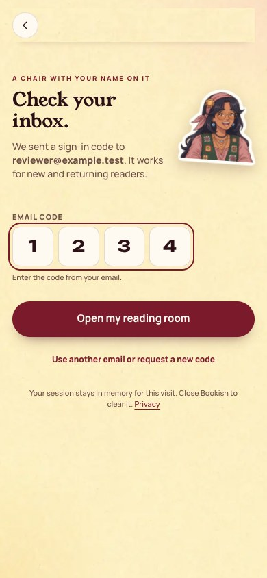
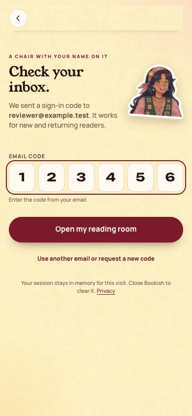
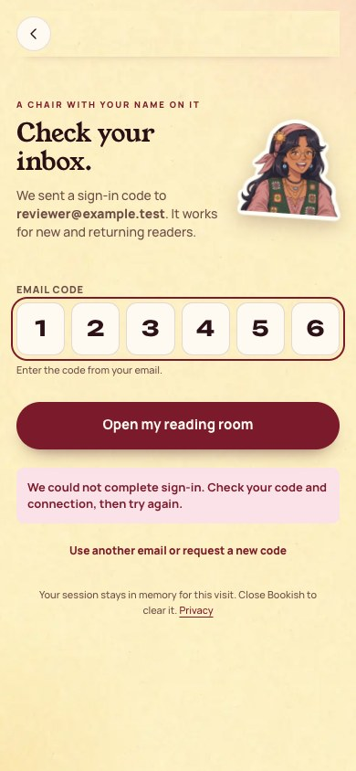

[All screens](../INDEX.md)

# 03. Email code

Oct 18 approval receipt verified.

**Existing surface: visual adaptation**

## Four-digit email code layout (UI support only)

The frontend input and layout support four digits. Authentication is intercepted locally; deployed server acceptance is not established by this capture.

| Approved reference | Actual app, 390 by 844 |
| --- | --- |
|  |  |

Overflow: none. Missing local assets: 0. Browser errors: 0. Em dash or emoji: none.

## Six-digit email code layout

| Approved reference | Actual app, 390 by 844 |
| --- | --- |
|  |  |

Overflow: none. Missing local assets: 0. Browser errors: 0. Em dash or emoji: none.

## Email-code validation error

| Approved reference | Actual app, 390 by 844 |
| --- | --- |
|  |  |

Overflow: none. Missing local assets: 0. Browser errors: 0. Em dash or emoji: none.

Original source: `/Users/vahallo/ted-screenshots/bookish-club/full-app-1016/html/03-email-code.html`.
