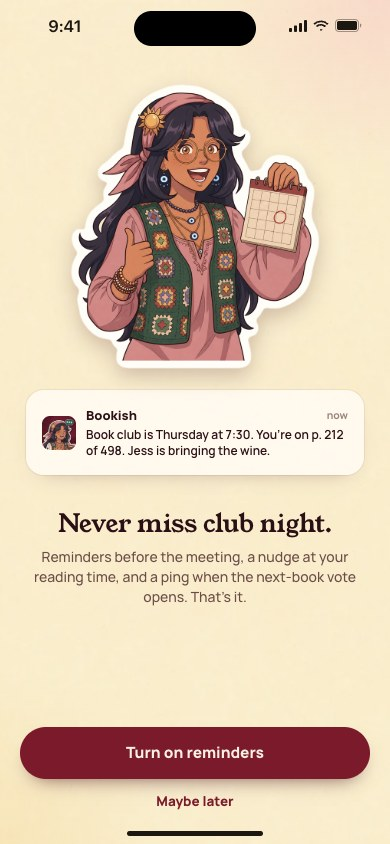
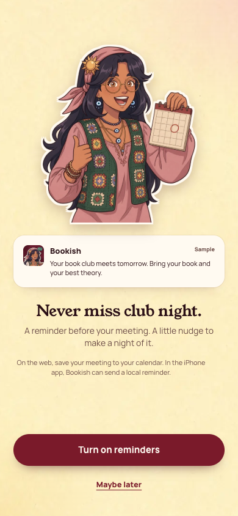

[All screens](../INDEX.md)

# 06. Reminders permission

Oct 18 approval receipt verified.

**Rebuilt and inspected, data adaptations documented (prior score 3/10)**

## Reminders permission prime

[Side-by-side PNG](/Users/vahallo/ted-ops/oneshots/1105-bookish40-fix/parity/06-notifications-prime.png)

| Approved reference | Actual app, 390 by 844 |
| --- | --- |
|  |  |

Overflow: none. Missing local assets: 0. Browser errors: 0. Em dash or emoji: none.

Original source: `/Users/vahallo/ted-screenshots/bookish-club/full-app-1016/html/06-notifications-prime.html`.
