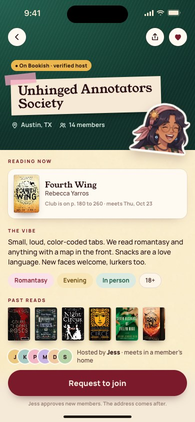
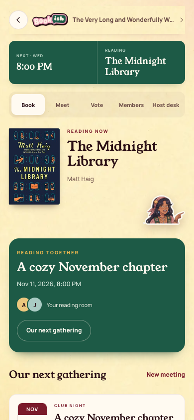
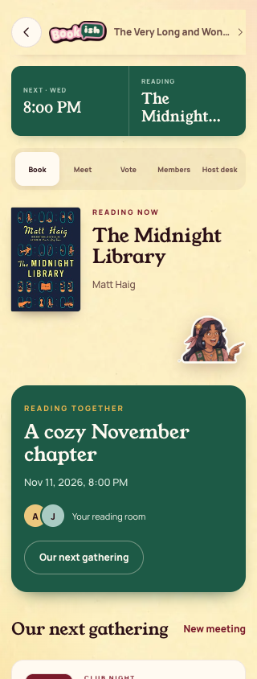

[All screens](../INDEX.md)

# 09. Club detail

Oct 18 approval receipt verified.

**Rebuilt and inspected, data adaptations documented (prior score 3/10)**

## Verified club detail

Only available directory fields are shown. The directory response has no member count, host name, or past-read history.

[Side-by-side PNG](external/review-evidence/1105-bookish40-fix/parity/09-club-detail.png)

| Approved reference | Actual app, 390 by 844 |
| --- | --- |
|  |  |

Overflow: none. Missing local assets: 0. Browser errors: 0. Em dash or emoji: none.

## Long club name on iPhone width

Long fixture data exercises the existing app layout.

[Side-by-side PNG](external/review-evidence/1105-bookish40-fix/parity/long-club-name.png)

| Approved reference | Actual app, 390 by 844 |
| --- | --- |
|  |  |

Overflow: none. Missing local assets: 0. Browser errors: 0. Em dash or emoji: none.

## Long club name at 320 pixels

Additional narrow-device stress capture; this one intentionally uses a 320 by 844 viewport.

| Approved reference | Actual app, 320 by 844 |
| --- | --- |
|  |  |

Overflow: none. Missing local assets: 0. Browser errors: 0. Em dash or emoji: none.

Original source: `external/approved-art/full-app-1016/html/09-club-detail.html`.
