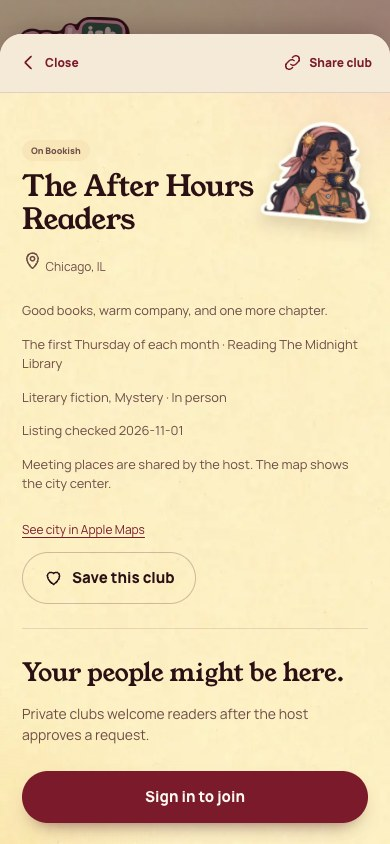
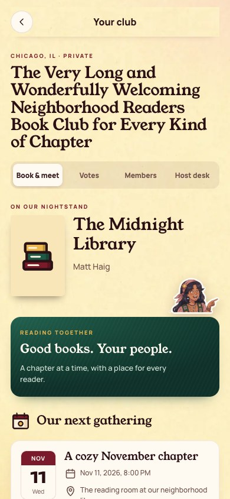
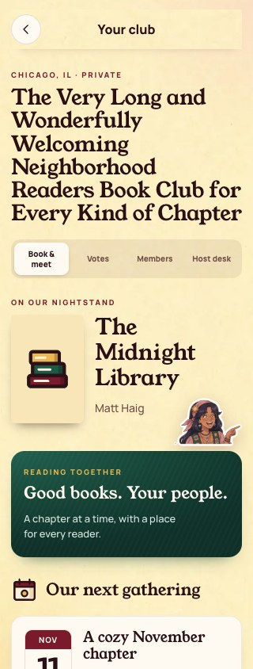

[All screens](../INDEX.md)

# 09. Club detail

Oct 18 approval receipt verified.

**Existing surface: visual adaptation**

## Verified club detail

| Approved reference | Actual app, 390 by 844 |
| --- | --- |
|  |  |

Overflow: none. Missing local assets: 0. Browser errors: 0. Em dash or emoji: none.

## Long club name on iPhone width

Long fixture data exercises the existing app layout.

| Approved reference | Actual app, 390 by 844 |
| --- | --- |
|  |  |

Overflow: none. Missing local assets: 0. Browser errors: 0. Em dash or emoji: none.

## Long club name at 320 pixels

Additional narrow-device stress capture; this one intentionally uses a 320 by 844 viewport.

| Approved reference | Actual app, 320 by 844 |
| --- | --- |
|  |  |

Overflow: none. Missing local assets: 0. Browser errors: 0. Em dash or emoji: none.

Original source: `/Users/vahallo/ted-screenshots/bookish-club/full-app-1016/html/09-club-detail.html`.
