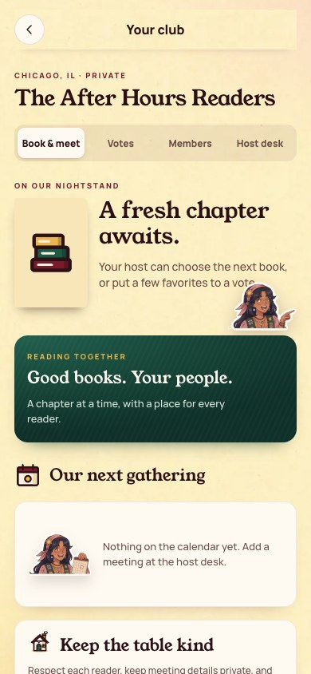

[All screens](../INDEX.md)

# 12. Join: approved

Oct 18 approval receipt verified.

**Partial: existing combined flow**

This is a partial mapping to working app behavior. The original screen composition and separate navigation are not fully implemented.

## Joined club after redeeming invitation

No standalone join-approved page exists. A successful join opens the actual club home.

| Approved reference | Actual app, 390 by 844 |
| --- | --- |
|  |  |

Overflow: none. Missing local assets: 0. Browser errors: 0. Em dash or emoji: none.

Original source: `/Users/vahallo/ted-screenshots/bookish-club/full-app-1016/html/12-join-approved.html`.
