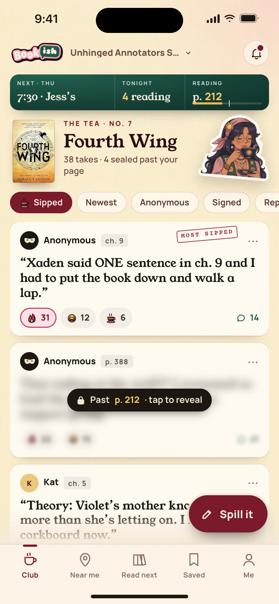
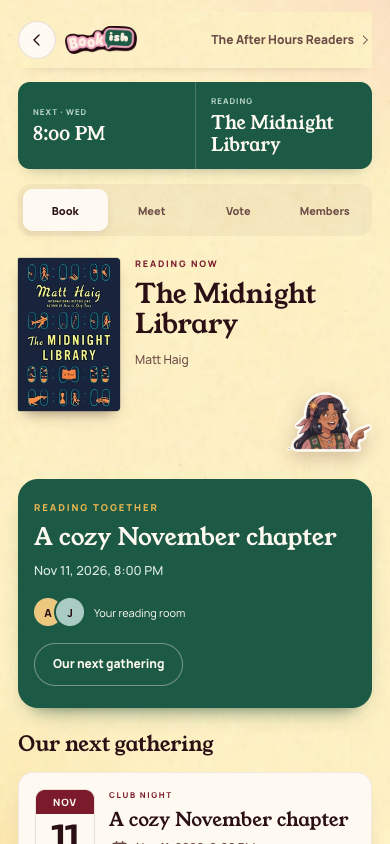

[All screens](../INDEX.md)

# 17. The Tea: club home

Oct 19 approved v2 override.

**Rebuilt and inspected, data adaptations documented (prior score 5/10)**

## Existing club home

The app combines its current book, meeting details, and safety controls in club home. No Tea feed has been added.

[Side-by-side PNG](external/review-evidence/1105-bookish40-fix/parity/17-club-home.png)

| Approved reference | Actual app, 390 by 844 |
| --- | --- |
|  |  |

Overflow: none. Missing local assets: 0. Browser errors: 0. Em dash or emoji: none.

## Member club view without host controls

The member fixture has no Host desk controls.

[Side-by-side PNG](external/review-evidence/1105-bookish40-fix/parity/member-club-home.png)

| Approved reference | Actual app, 390 by 844 |
| --- | --- |
|  |  |

Overflow: none. Missing local assets: 0. Browser errors: 0. Em dash or emoji: none.

Original source: `external/approved-art/full-app-1016/html/17-the-tea.html`.
