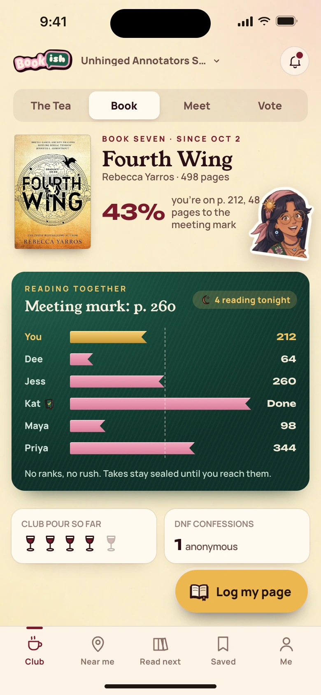

[All screens](../INDEX.md)

# 20. Current book and reading together (v2)

Oct 19 approved v2 override.

**Partial: existing combined flow**

This is a partial mapping to working app behavior. The original screen composition and separate navigation are not fully implemented.

## Current book in existing club home

The app has a shared current-book section. Reading-progress tracking is absent.

| Approved reference | Actual app, 390 by 844 |
| --- | --- |
|  |  |

Overflow: none. Missing local assets: 0. Browser errors: 0. Em dash or emoji: none.

Original source: `/Users/vahallo/ted-screenshots/bookish-club/full-app-1016/html/20-book-and-race.html`.
