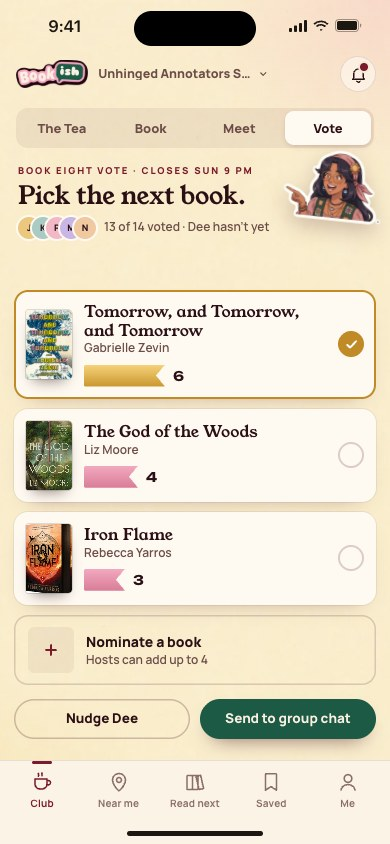
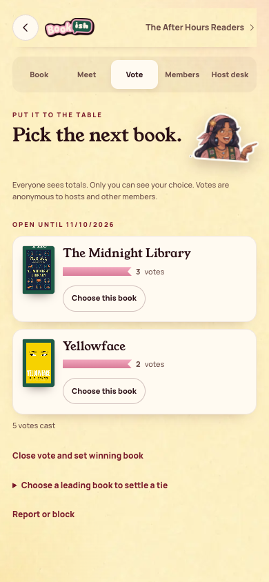
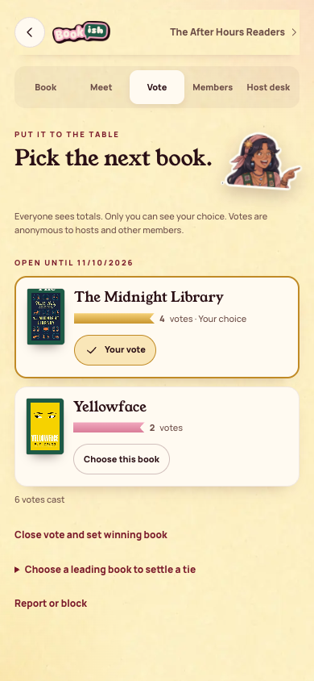
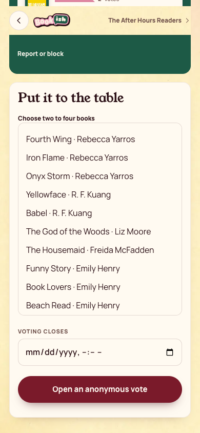
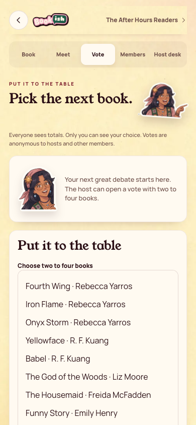

[All screens](../INDEX.md)

# 22. Vote: pick the next book

Oct 18 approval receipt verified.

**Rebuilt and inspected, data adaptations documented (prior score 7/10)**

## Anonymous book vote

[Side-by-side PNG](external/review-evidence/1105-bookish40-fix/parity/22-vote.png)

| Approved reference | Actual app, 390 by 844 |
| --- | --- |
|  |  |

Overflow: none. Missing local assets: 0. Browser errors: 0. Em dash or emoji: none.

## Anonymous vote, selected choice

[Side-by-side PNG](external/review-evidence/1105-bookish40-fix/parity/22-vote-selected.png)

| Approved reference | Actual app, 390 by 844 |
| --- | --- |
|  |  |

Overflow: none. Missing local assets: 0. Browser errors: 0. Em dash or emoji: none.

## Host anonymous vote form

Existing host form opens after the previous vote closes.

[Side-by-side PNG](external/review-evidence/1105-bookish40-fix/parity/22-open-vote.png)

| Approved reference | Actual app, 390 by 844 |
| --- | --- |
|  |  |

Overflow: none. Missing local assets: 0. Browser errors: 0. Em dash or emoji: none.

## No active book votes

[Side-by-side PNG](external/review-evidence/1105-bookish40-fix/parity/empty-votes.png)

| Approved reference | Actual app, 390 by 844 |
| --- | --- |
|  |  |

Overflow: none. Missing local assets: 0. Browser errors: 0. Em dash or emoji: none.

Original source: `external/approved-art/full-app-1016/html/22-vote.html`.
