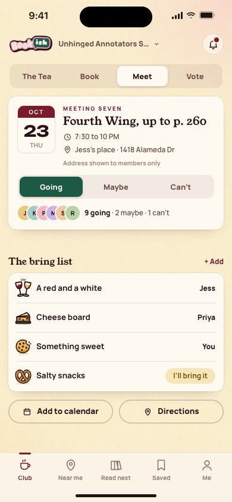
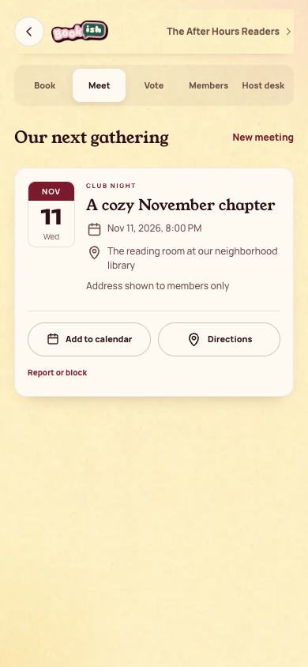

[All screens](../INDEX.md)

# 24. meeting rsvp

Oct 18 batch reference; individual approval not recorded in decisions 111-143.

**Rebuilt and inspected, data adaptations documented (prior score 5/10)**

## Member-only meeting details

Existing app has meeting details, with calendar reminders in public detail. It has no in-app RSVP action.

[Side-by-side PNG](/Users/vahallo/ted-ops/oneshots/1105-bookish40-fix/parity/24-meeting.png)

| Approved reference | Actual app, 390 by 844 |
| --- | --- |
|  |  |

Overflow: none. Missing local assets: 0. Browser errors: 0. Em dash or emoji: none.

Original source: `/Users/vahallo/ted-screenshots/bookish-club/full-app-1016/html/24-meeting-rsvp.html`.
