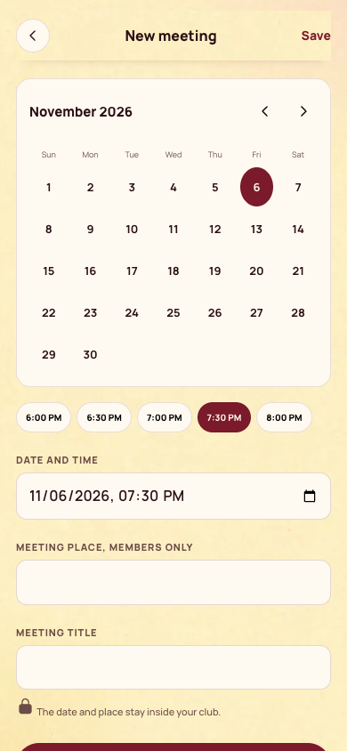
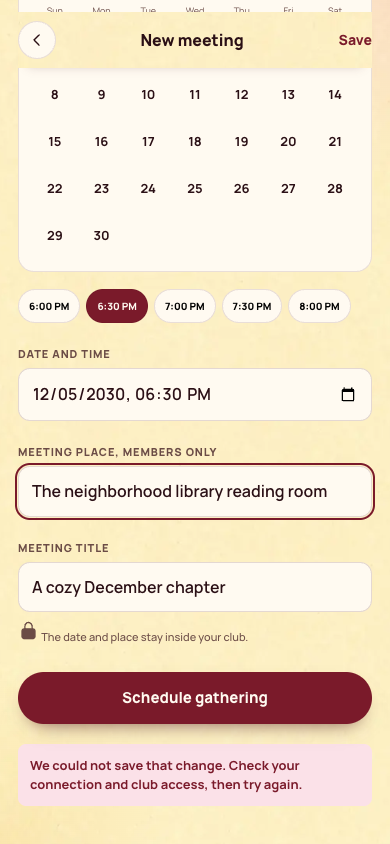

[All screens](../INDEX.md)

# 25. Schedule a meeting (host)

Oct 18 approval receipt verified.

**Rebuilt and inspected, data adaptations documented (prior score 4/10)**

## New meeting calendar sheet

Calendar and time controls update the existing date/time field. Bring lists, chat posting, and group notification toggles have no existing app payload and are omitted.

[Side-by-side PNG](/Users/vahallo/ted-ops/oneshots/1105-bookish40-fix/parity/25-schedule-meeting.png)

| Approved reference | Actual app, 390 by 844 |
| --- | --- |
|  |  |

Overflow: none. Missing local assets: 0. Browser errors: 0. Em dash or emoji: none.

## Meeting form save error

A fixture rejects the save, and the real form retains the draft.

[Side-by-side PNG](/Users/vahallo/ted-ops/oneshots/1105-bookish40-fix/parity/25-schedule-error.png)

| Approved reference | Actual app, 390 by 844 |
| --- | --- |
|  |  |

Overflow: none. Missing local assets: 0. Browser errors: 0. Em dash or emoji: none.

Original source: `/Users/vahallo/ted-screenshots/bookish-club/full-app-1016/html/25-schedule-meeting.html`.
