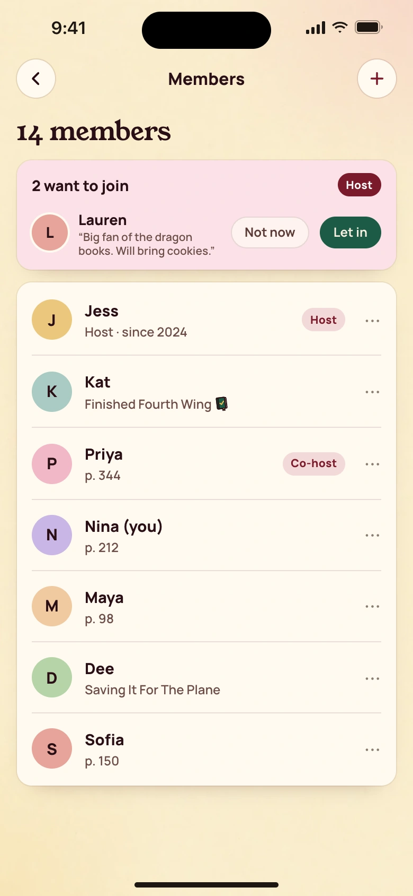
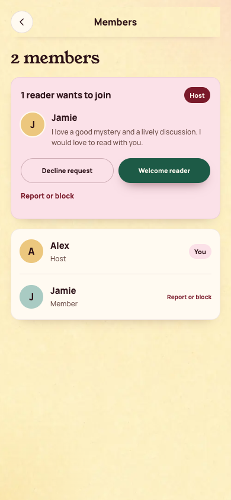
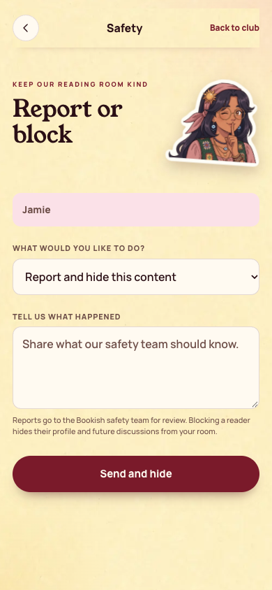
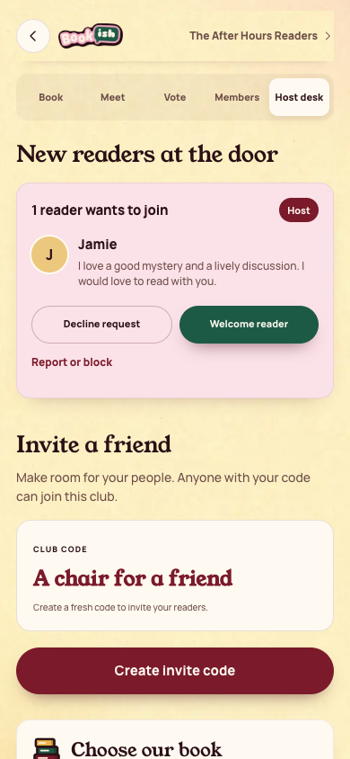

[All screens](../INDEX.md)

# 26. Member list

Oct 19 approved v2 override.

**Rebuilt and inspected, data adaptations documented (prior score 7/10)**

## Club members

[Side-by-side PNG](/Users/vahallo/ted-ops/oneshots/1105-bookish40-fix/parity/26-members.png)

| Approved reference | Actual app, 390 by 844 |
| --- | --- |
|  |  |

Overflow: none. Missing local assets: 0. Browser errors: 0. Em dash or emoji: none.

## Report or block a reader

Existing safety form, with no new content model.

[Side-by-side PNG](/Users/vahallo/ted-ops/oneshots/1105-bookish40-fix/parity/safety.png)

| Approved reference | Actual app, 390 by 844 |
| --- | --- |
|  |  |

Overflow: none. Missing local assets: 0. Browser errors: 0. Em dash or emoji: none.

## Host desk and pending join request

Host controls and pending reader approvals share the existing Host desk.

[Side-by-side PNG](/Users/vahallo/ted-ops/oneshots/1105-bookish40-fix/parity/host-desk.png)

| Approved reference | Actual app, 390 by 844 |
| --- | --- |
|  |  |

Overflow: none. Missing local assets: 0. Browser errors: 0. Em dash or emoji: none.

Original source: `/Users/vahallo/ted-screenshots/bookish-club/full-app-1016/html/26-members.html`.
