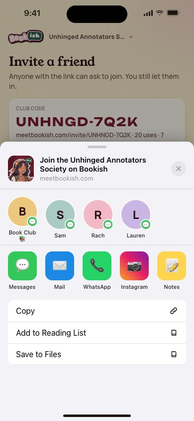
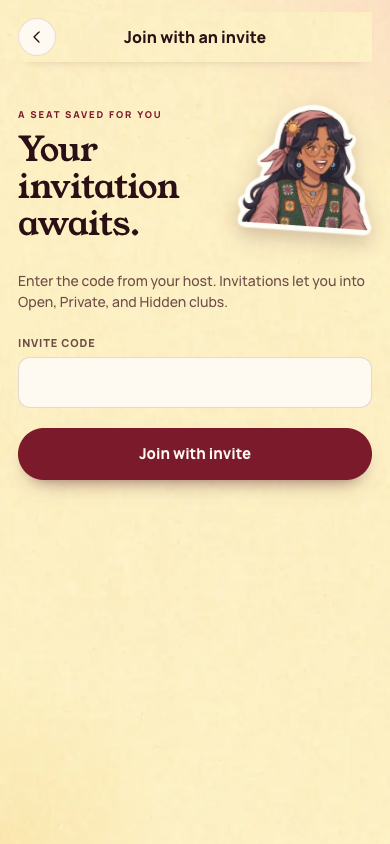
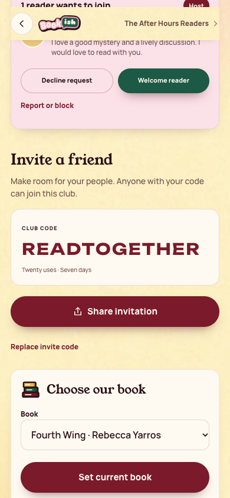

[All screens](../INDEX.md)

# 27. Invite: native share sheet

Oct 18 approval receipt verified.

**Rebuilt and inspected, data adaptations documented (prior score 5/10)**

## Redeem an invitation

The existing flow uses an invite-code form. Share invitation is captured separately.

[Side-by-side PNG](external/review-evidence/1105-bookish40-fix/parity/27-redeem-invite.png)

| Approved reference | Actual app, 390 by 844 |
| --- | --- |
|  |  |

Overflow: none. Missing local assets: 0. Browser errors: 0. Em dash or emoji: none.

## Share invitation from Host desk

The real browser share action is not triggered; it would hand off to the operating system.

[Side-by-side PNG](external/review-evidence/1105-bookish40-fix/parity/27-share-invite.png)

| Approved reference | Actual app, 390 by 844 |
| --- | --- |
|  |  |

Overflow: none. Missing local assets: 0. Browser errors: 0. Em dash or emoji: none.

Original source: `external/approved-art/full-app-1016/html/27-invite-share-sheet.html`.
