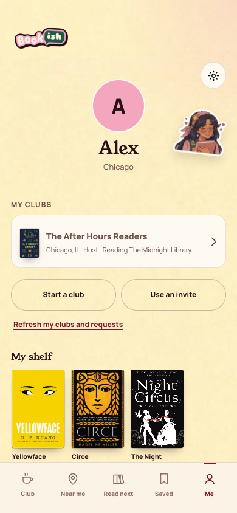
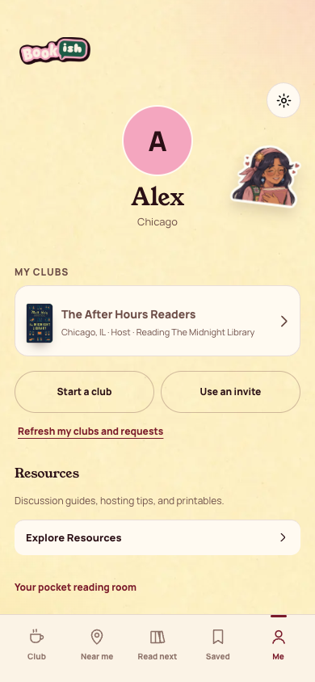
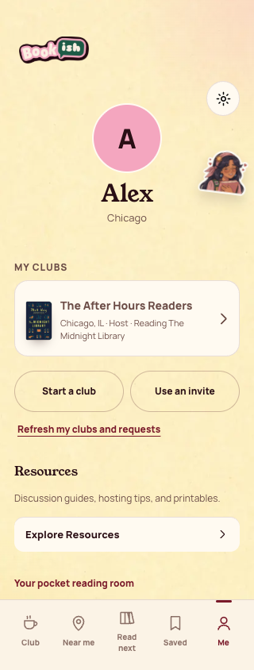

[All screens](../INDEX.md)

# 29. Profile

Oct 18 approval receipt verified.

**Rebuilt and inspected, data adaptations documented (prior score 4/10)**

## Account profile, clubs, and My shelf

Local Saved-book preferences are seeded fixtures. No reading scores or streaks are added.

[Side-by-side PNG](external/review-evidence/1105-bookish40-fix/parity/29-profile.png)

| Approved reference | Actual app, 390 by 844 |
| --- | --- |
|  |  |

Overflow: none. Missing local assets: 0. Browser errors: 0. Em dash or emoji: none.

## Account profile with a long email

A valid 64-character email local part exercises the account greeting beside approved art.

[Side-by-side PNG](external/review-evidence/1105-bookish40-fix/parity/29-profile-long-email.png)

| Approved reference | Actual app, 390 by 844 |
| --- | --- |
|  |  |

Overflow: none. Missing local assets: 0. Browser errors: 0. Em dash or emoji: none.

## Account profile with a long email at 320 pixels

Additional narrow-device stress capture at 320 by 844.

| Approved reference | Actual app, 320 by 844 |
| --- | --- |
|  |  |

Overflow: none. Missing local assets: 0. Browser errors: 0. Em dash or emoji: none.

Original source: `external/approved-art/full-app-1016/html/29-profile.html`.
