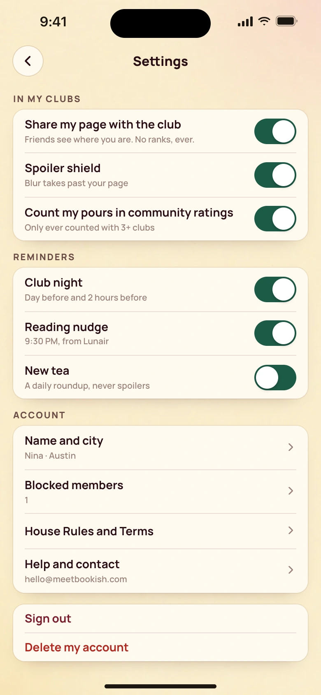
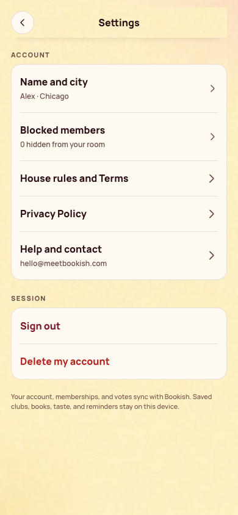

[All screens](../INDEX.md)

# 30. Settings and privacy

Oct 19 approved v2 override.

**Rebuilt and inspected, data adaptations documented (prior score 4/10)**

## Settings and privacy

[Side-by-side PNG](/Users/vahallo/ted-ops/oneshots/1105-bookish40-fix/parity/30-settings.png)

| Approved reference | Actual app, 390 by 844 |
| --- | --- |
|  |  |

Overflow: none. Missing local assets: 0. Browser errors: 0. Em dash or emoji: none.

## Account deletion confirmation

Existing destructive-action confirmation is retained.

[Side-by-side PNG](/Users/vahallo/ted-ops/oneshots/1105-bookish40-fix/parity/delete-account.png)

| Approved reference | Actual app, 390 by 844 |
| --- | --- |
|  |  |

Overflow: none. Missing local assets: 0. Browser errors: 0. Em dash or emoji: none.

Original source: `/Users/vahallo/ted-screenshots/bookish-club/full-app-1016/html/30-settings.html`.
