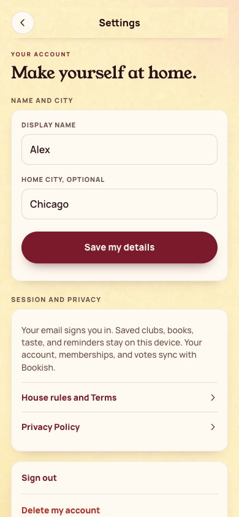

[All screens](../INDEX.md)

# 30. Settings and privacy

Oct 19 approved v2 override.

**Existing surface: visual adaptation**

## Settings and privacy

| Approved reference | Actual app, 390 by 844 |
| --- | --- |
|  |  |

Overflow: none. Missing local assets: 0. Browser errors: 0. Em dash or emoji: none.

## Account deletion confirmation

Existing destructive-action confirmation is retained.

| Approved reference | Actual app, 390 by 844 |
| --- | --- |
|  |  |

Overflow: none. Missing local assets: 0. Browser errors: 0. Em dash or emoji: none.

Original source: `/Users/vahallo/ted-screenshots/bookish-club/full-app-1016/html/30-settings.html`.
