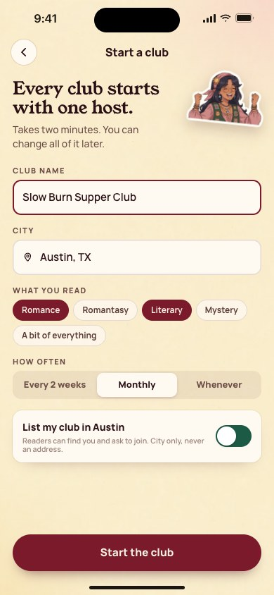
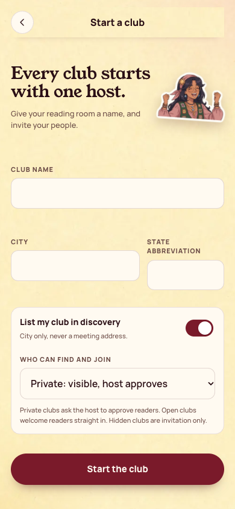

[All screens](../INDEX.md)

# 31. Start a club

Oct 18 approval receipt verified.

**Rebuilt and inspected, data adaptations documented (prior score 5/10)**

## Create club, including visibility and location fields

The existing create RPC accepts name, city, state, and visibility. Genre and cadence controls are absent because those values have no existing storage or payload fields.

[Side-by-side PNG](external/review-evidence/1105-bookish40-fix/parity/31-create-club.png)

| Approved reference | Actual app, 390 by 844 |
| --- | --- |
|  |  |

Overflow: none. Missing local assets: 0. Browser errors: 0. Em dash or emoji: none.

Original source: `external/approved-art/full-app-1016/html/31-start-a-club.html`.
