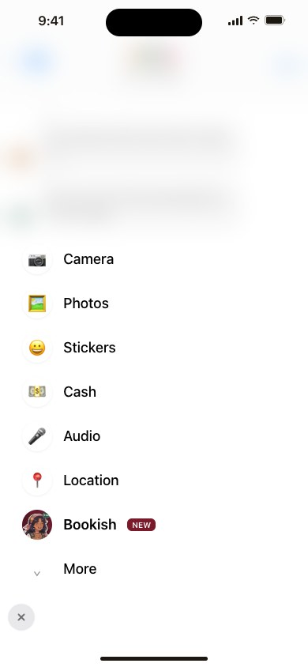
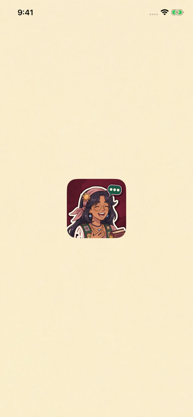

[All screens](../INDEX.md)

# 38. iMessage: app drawer (+ menu)

Oct 18 approval receipt verified.

**Partial: native UIKit review host**

Bundled icon preview in an isolated native review host. Apple’s Messages drawer is not captured.

[Native provenance, reproduction, and device-validation limits](../native/README.md).

| Approved reference | Actual UIKit content in standalone simulator host |
| --- | --- |
|  |  |

Additional actual native states: [drawer icon](../native/actual/drawer-icon.png).

Original source: `external/approved-art/full-app-1016/html/38-imessage-app-drawer.html`.
