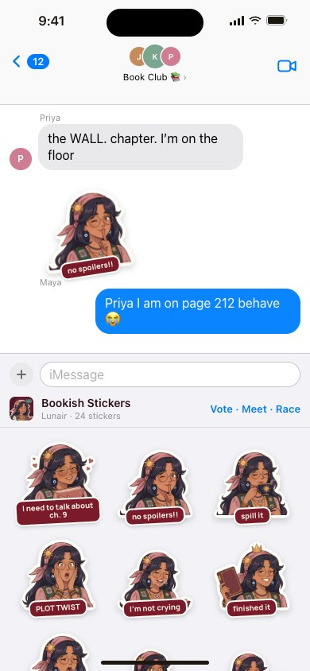
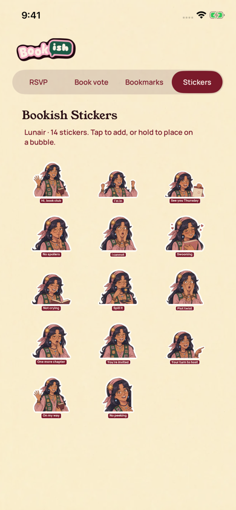

[All screens](../INDEX.md)

# 39. imessage sticker pack

Oct 18 batch reference; individual approval not recorded in decisions 111-143.

**Rebuilt and inspected, native review host (prior score 6/10)**

Actual native sticker browser in an isolated UIKit review host. The existing fourteen sticker identifiers are retained.

[Native provenance, reproduction, and device-validation limits](../native/README.md).

| Approved reference | Actual UIKit content in standalone simulator host |
| --- | --- |
|  |  |

Additional actual native states: [stickers](../native/actual/stickers.png).

Original source: `external/approved-art/full-app-1016/html/39-imessage-sticker-pack.html`.
