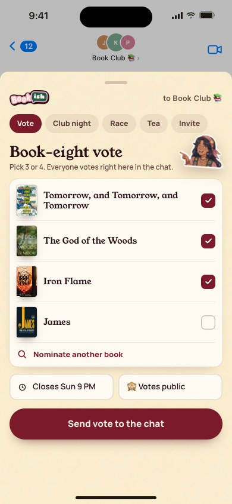
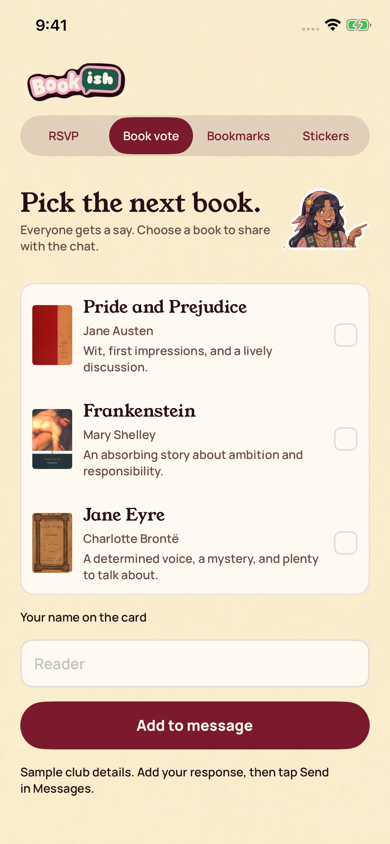

[All screens](../INDEX.md)

# 40. imessage extension send vote

Oct 18 batch reference; individual approval not recorded in decisions 111-143.

**Rebuilt and inspected, native review host (prior score 7/10)**

Actual production vote editor in a standalone simulator host, including error and large-text states. Apple’s conversation, keyboard, and transport are not captured.

[Native provenance, reproduction, and device-validation limits](../native/README.md).

| Approved reference | Actual UIKit content in standalone simulator host |
| --- | --- |
|  |  |

Additional actual native states: [editor vote](../native/actual/editor-vote.png), [editor vote scrolled](../native/actual/editor-vote-scrolled.png), [editor vote error scrolled](../native/actual/editor-vote-error-scrolled.png), [editor vote large type](../native/actual/editor-vote-large-type.png), [editor vote large type scrolled](../native/actual/editor-vote-large-type-scrolled.png).

Original source: `/Users/vahallo/ted-screenshots/bookish-club/full-app-1016/html/40-imessage-extension-send-vote.html`.
