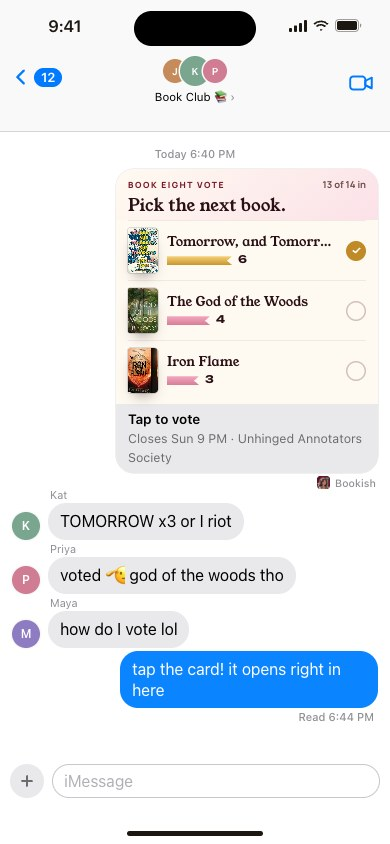
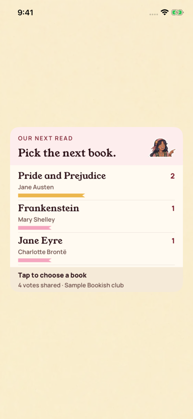

[All screens](../INDEX.md)

# 41. iMessage: live vote bubble

Oct 18 approval receipt verified.

**Rebuilt and inspected, native review host (prior score 7/10)**

Actual CardRenderer output hosted in UIKit. Apple’s Messages transcript chrome and transport are not captured.

[Native provenance, reproduction, and device-validation limits](../native/README.md).

| Approved reference | Actual UIKit content in standalone simulator host |
| --- | --- |
|  |  |

Additional actual native states: [transcript vote](../native/actual/transcript-vote.png).

Original source: `external/approved-art/full-app-1016/html/41-imessage-live-vote.html`.
