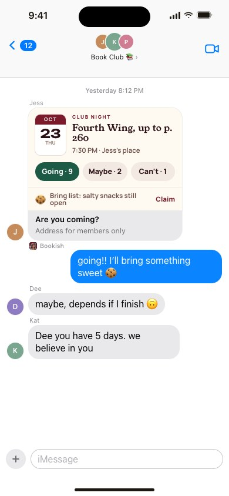
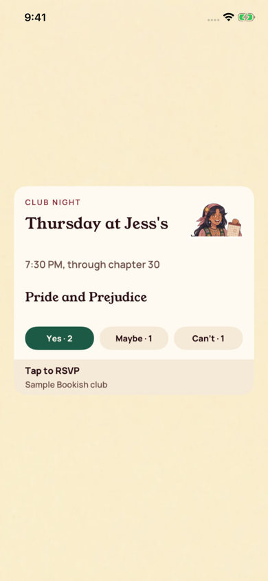

[All screens](../INDEX.md)

# 42. iMessage: meeting RSVP bubble

Oct 18 approval receipt verified.

**Partial: native UIKit review host**

Actual RSVP card and editor in the native review host. Apple’s host, incoming delivery, and send transport require device validation.

[Native provenance, reproduction, and device-validation limits](../native/README.md).

| Approved reference | Actual UIKit content in standalone simulator host |
| --- | --- |
|  |  |

Additional actual native states: [transcript rsvp](../native/actual/transcript-rsvp.png), [editor rsvp](../native/actual/editor-rsvp.png), [transcript rsvp long](../native/actual/transcript-rsvp-long.png).

Original source: `/Users/vahallo/ted-screenshots/bookish-club/full-app-1016/html/42-imessage-rsvp.html`.
