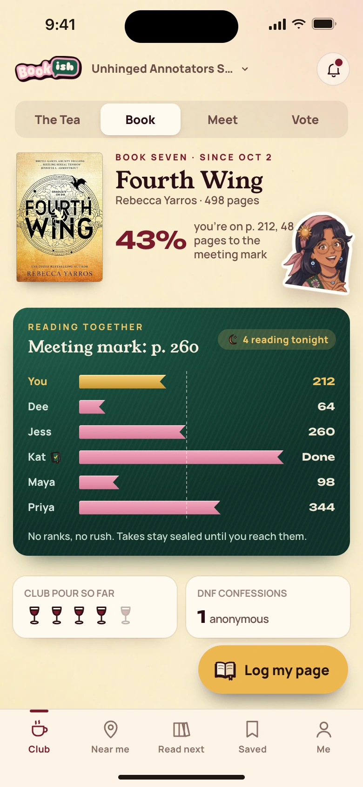
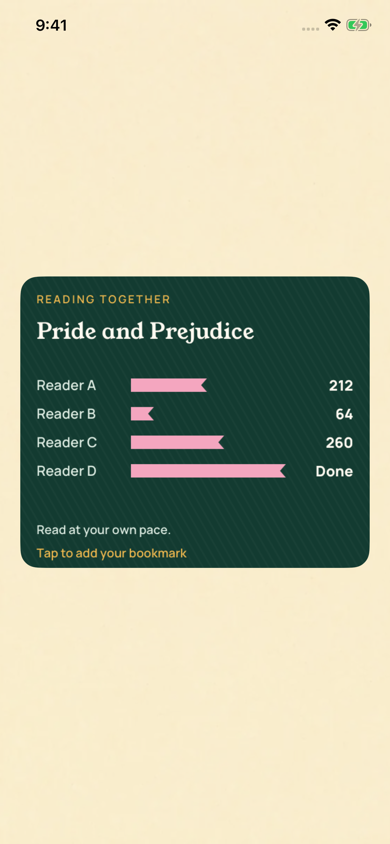

[All screens](../INDEX.md)

# 43. Reading together (v2)

Oct 19 approved v2 override.

**Rebuilt and inspected, native review host (prior score 7/10)**

Actual communal bookmarks card and editor follow the v2 reading-together reference. Member order is preserved, with no ranked reading view.

[Native provenance, reproduction, and device-validation limits](../native/README.md).

| Approved reference | Actual UIKit content in standalone simulator host |
| --- | --- |
|  |  |

Additional actual native states: [transcript bookmarks](../native/actual/transcript-bookmarks.png), [editor bookmarks](../native/actual/editor-bookmarks.png), [transcript bookmarks empty](../native/actual/transcript-bookmarks-empty.png).

Original source: `external/approved-art/full-app-1016/html/43-imessage-reading-race.html`.
